# Pending assets

Every asset in the finished game is either **hand made** or taken from an **open-source
library** whose licence allows it (see [AGENTS.md → Assets](AGENTS.md#assets)). Sometimes a
change needs an asset before the real one exists. In that case it uses a temporary
placeholder, and the placeholder is listed here until the real asset replaces it.

This rule doesn't cover work done in code or simple edits of existing assets: particle
effects, tints and flashes from shaders, slices, flips and crops of sprites, or sounds that
are pitched, reversed or filtered versions of other sounds.

**Adding a placeholder:** add a row to the right table, with:

- **Name**: the file, plus the frame or cell if it only takes up part of a sheet.
- **Used for**: where it shows up in the game, or the code that uses it.
- **Preview**: a PNG for still art, a GIF for an animation (scaled up, with nearest-neighbour
  filtering), or a link to the sound file. Put previews in [docs/pending_assets/](docs/pending_assets/).
  That folder has a `.gdignore`, so Godot doesn't import them.

**Replacing a placeholder:** drop the real asset in, delete its row and its preview image,
and note where the new asset came from (its licence, or that it's hand made). Sounds get a
line in `assets/sfx/SOURCE.txt`.

## Sprites and animations

| Name | Used for | Preview |
| --- | --- | --- |
| `special_tiles.png` frame 13 (`PASTE`) | Thermal paste that holds whoever steps in |  |
| `assets/sprites/merchant/merchant.png` | The merchant in the start room ([Merchant.tscn](src/npcs/Merchant.tscn)): the reference image the developer supplied, used as it is and scaled down in the scene (0.095x, smoothed with mipmaps). Licence unknown, so it must be replaced with real pixel art (standing, maybe idle) | 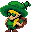 |
| `assets/sprites/hud/upgrade_time.png` | Time upgrade icon on the shop's Upgrades tab ([Upgrades.gd](src/items/Upgrades.gd)), drawn by script | 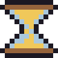 |
| `assets/sprites/hud/upgrade_looting.png` | Looting upgrade icon on the shop's Upgrades tab, drawn by script | 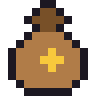 |
| `assets/sprites/hud/item_skeleton_key.png` | Skeleton key icon in the item bar ([Items.gd](src/items/Items.gd)), drawn by script | 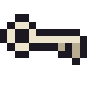 |
| `assets/sprites/hud/item_metal_detector.png` | Metal detector icon in the item bar ([Items.gd](src/items/Items.gd)), drawn by script | 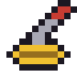 |
| Troll (no art of its own) | [Troll.tscn](src/enemies/Troll.tscn) uses the goblin's sprites with a gold `self_modulate`. Needs its own sprite set (stand, walk, slash, all four facings) |  |
| Orc (no art of its own) | [Orc.tscn](src/enemies/Orc.tscn) uses the goblin's sprites scaled 1.5x (shown on the right, with a goblin on the left). Needs its own sprite set |  |
| Warlock (no art of its own) | [Warlock.tscn](src/enemies/Warlock.tscn) uses the wizard's sprites with a green `self_modulate` (see [Caster.gd](src/enemies/Caster.gd)). Needs its own sprite set (stand, walk, shoot) |  |
| Necromancer (no art of its own) | [Necromancer.tscn](src/enemies/Necromancer.tscn) uses the wizard's sprites with a purple `self_modulate`. Needs its own sprite set | 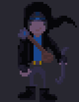 |
| `assets/sprites/wyrm/wyvern_*.png` (all 16 sheets) | Wyvern ([Wyvern.tscn](src/enemies/Wyvern.tscn)): a red, winged, two-legged dragon drawn as a placeholder, same actions and facings | 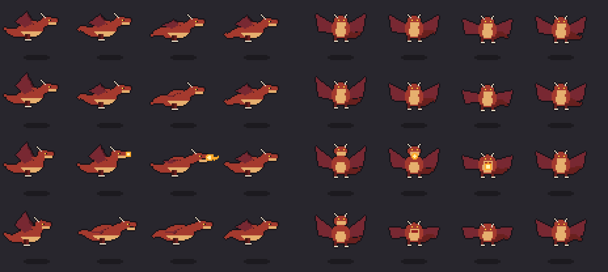 |
| `assets/sprites/centaur/centaur_*.png` (all 16 sheets) | Cyber Centaur ([Centaur.tscn](src/enemies/Centaur.tscn)): a horse body with an armoured rider holding a halberd, drawn by script as a placeholder. Idle, walk, slash (the clash hit) and slash_kick (turned away, kicking with its hind legs) in all four facings. The preview rows are those actions; the columns face right, left, up and down. | 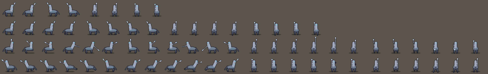 |
| `assets/sprites/centaur/bucentaur_*.png` (all 20 sheets) | Cyber Bucentaur ([Bucentaur.tscn](src/enemies/Bucentaur.tscn)): a bull body with a horned rider. The centaur's actions plus slash_charge, the lance levelled for its charge | 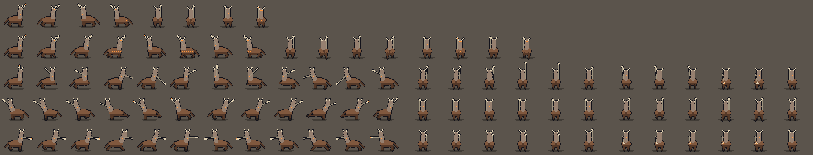 |
| `assets/sprites/centaur/taurtaur_*.png` (all 24 sheets) | Cyber Taurtaur ([Taurtaur.tscn](src/enemies/Taurtaur.tscn)): two horse bottoms joined by a shared neck, the top one upside down and facing the other way. Slash is its front-hoof stomp (the group-rush clash), slash_charge is its lunge, slash_kick is the bottom half's hind-leg kick and slash_kick_top the top half's. Its sheets are named by the way the bottom half faces, and it never turns to kick. | 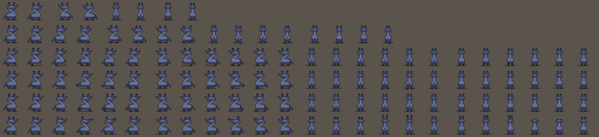 |
| Spin attack (no art of its own) | The player's charged spin ([Player.gd](src/player/Player.gd) `_start_spin`) holds frame 6 of `jason_*_slash.png` and rotates the whole sprite once. Needs a real spin animation, all four facings | 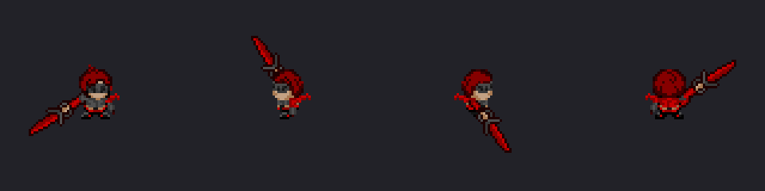 |
| `assets/sprites/goblin/goblin_*_slash.png` | The goblin's attack ([Goblin.tscn](src/enemies/Goblin.tscn) `slash_*`; Troll and Orc borrow it too). Needs redoing | 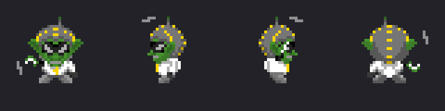 |
| `assets/sprites/wizard/wizard_*.png` (stand, walk, shoot) | Every wizard sprite ([Wizard.tscn](src/enemies/Wizard.tscn); Warlock and Necromancer borrow them too). Need redoing | 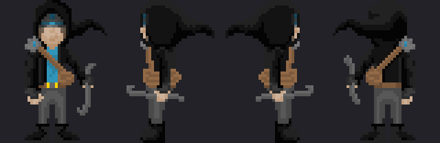 |
| `assets/sprites/skelly/skeleton_knight_*.png` (idle, walking, shooting, slashing) | Every boss sprite ([Boss.tscn](src/enemies/Boss.tscn)). Need redoing | 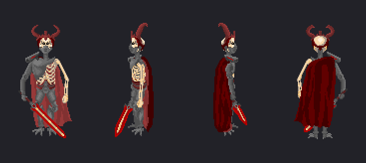 |
| `assets/sprites/hud/arrow_count.png` | Icon next to the arrow count on the HUD ([GameCamera.tscn](src/world/GameCamera.tscn) `Hud/Arrows/Icon`) | 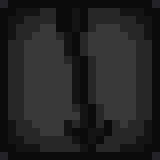 |
| `assets/sprites/server/server.png` and `server_silver.png` | Server ([Server.tscn](src/enemies/Server.tscn)): a server tower with blinking drive lights, drawn by script as a placeholder (four idle frames). The silver sheet is a premium (floor) server, bright so it stands apart from the dark normal one (top row normal, bottom row silver). The light on its cap is drawn in code in the boost's colour | 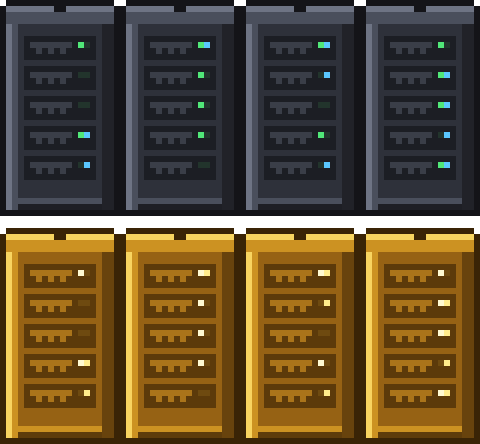 |
| `status_icons.png` cell 14 (`Icon.ATTACK_UP`) | Status-bar icon over an enemy under a server's attack boost: the attack-down sword with a green up arrow, edited by script | 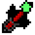 |
| `status_icons.png` cell 15 (`Icon.DEFENSE_UP`) | Status-bar icon over an enemy under a server's defense boost: the defense-down shield with its arrows flipped up and turned green, edited by script | 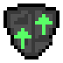 |

## Sound effects

All of these were synthesized by script for this project, so none of them is hand made or
from a library.

| Name | Used for | Preview |
| --- | --- | --- |
| `twinkle.wav` | An enemy's "about to strike" twinkle, and traps going live ([Juice.gd](src/autoload/Juice.gd)); also the metal detector finding a key room ([ItemBar.gd](src/ui/hud/ItemBar.gd)) | [assets/sfx/twinkle.wav](assets/sfx/twinkle.wav) |
| `tile_speed_up.wav` | Stepping onto a speed tile ([Player.gd](src/player/Player.gd)) | [assets/sfx/tile_speed_up.wav](assets/sfx/tile_speed_up.wav) |
| `tile_slow_down.wav` | Stepping onto a slow tile | [assets/sfx/tile_slow_down.wav](assets/sfx/tile_slow_down.wav) |
| `paste_stick.wav` | Thermal paste first catching someone ([SpecialTiles.gd](src/world/SpecialTiles.gd)) | [assets/sfx/paste_stick.wav](assets/sfx/paste_stick.wav) |
| `paste_stretch.wav` | Someone pulling against paste | [assets/sfx/paste_stretch.wav](assets/sfx/paste_stretch.wav) |
| `paste_snap.wav` | Paste snapping someone back | [assets/sfx/paste_snap.wav](assets/sfx/paste_snap.wav) |
| `server_hit.wav` | A server being hit ([Server.gd](src/enemies/Server.gd)) | [assets/sfx/server_hit.wav](assets/sfx/server_hit.wav) |
| `server_break.wav` | A server breaking | [assets/sfx/server_break.wav](assets/sfx/server_break.wav) |
| `server_alert.wav` | The floor server banner as a floor starts ([FloorBanner.gd](src/ui/hud/FloorBanner.gd)) | [assets/sfx/server_alert.wav](assets/sfx/server_alert.wav) |
| `clank_bad.wav`, reused for the item bar | Pressing use on an item that would do nothing, or on an empty box ([ItemBar.gd](src/ui/hud/ItemBar.gd) `REFUSED_SOUND`, pitched up 1.6x like the jammed bow's click), and a purchase the shop refuses ([ShopMenu.gd](src/ui/menus/ShopMenu.gd)). The sound itself is final for blocked swings; the item bar needs a sound of its own | [assets/sfx/clank_bad.wav](assets/sfx/clank_bad.wav) |
| `coin_bad.wav`, reused for the shop | Buying something from the merchant ([ShopMenu.gd](src/ui/menus/ShopMenu.gd) via `Juice.coin_stolen_sound`). It's the final sound for a troll stealing coins; the shop needs a purchase sound of its own | [assets/sfx/coin_bad.wav](assets/sfx/coin_bad.wav) |

## Music

None at the moment.

## Fonts

None at the moment.

## Source not verified

These aren't known to be placeholders, but nobody has recorded where they came from or
under what licence. Confirm the source and licence (and record them next to the asset), or
replace the asset.

| Name | Used for | Preview |
| --- | --- | --- |
| `assets/fonts/8-BIT WONDER.TTF` | Every menu and HUD label (Boot, PauseMenu, OptionsPanel and GameCamera scenes; ShopMenu and the button prompts draw with it too) | [assets/fonts/8-BIT WONDER.TTF](<assets/fonts/8-BIT WONDER.TTF>) |
