# Pending assets

Every asset in the finished game is either **hand made** or taken from an **open-source
library** whose licence allows it (see [AGENTS.md → Assets](AGENTS.md#assets)). Sometimes a
change needs an asset before the real one exists. In that case it uses a temporary
placeholder, and the placeholder is listed here until the real asset replaces it.

This rule doesn't cover work done in code or simple edits of existing assets: particle
effects, tints and flashes from shaders, slices, flips and crops of sprites, or sounds that
are pitched, reversed or filtered versions of other sounds.

**Adding a placeholder:** add a row to the right table, with:

- **Name**: the file, plus the frame or cell if it only takes up part of a sheet.
- **Used for**: where it shows up in the game, or the code that uses it.
- **Preview**: a PNG for still art, a GIF for an animation (scaled up, with nearest-neighbour
  filtering), or a link to the sound file. Put previews in [docs/pending_assets/](docs/pending_assets/).
  That folder has a `.gdignore`, so Godot doesn't import them.

**Replacing a placeholder:** drop the real asset in, delete its row and its preview image,
and note where the new asset came from (its licence, or that it's hand made). Sounds get a
line in `assets/sfx/SOURCE.txt`.

## Sprites and animations

| Name | Used for | Preview |
| --- | --- | --- |
| `assets/sprites/tiles/special_tiles.png` frames 0-3 (`WIRES`, `WIRES_SPARK`, `WIRES_LIVE`, `WIRES_BROKEN`) | Exposed-wire trap: resting, sparking, live, broken by a sword ([SpecialTiles.gd](src/world/SpecialTiles.gd)) | 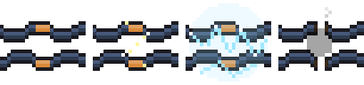 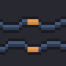 |
| `special_tiles.png` frame 4 (`SPIKES`) | Spike trap | 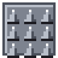 |
| `special_tiles.png` frames 5-7 (`CRACKED`, `CRACKING`, `HOLE`) | Cracked floor that gives way into a pit and then mends | 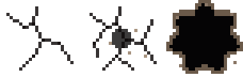 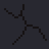 |
| `special_tiles.png` frame 8 (`SLICK`) | Slick (icy) floor | 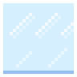 |
| `special_tiles.png` frames 9-12 (`PLATE`, `PLATE_DOWN`, `PLATE_LIVE`, `PLATE_BROKEN`) | Pressure plate: armed, pressed, live, broken | 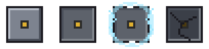 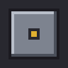 |
| `special_tiles.png` frame 13 (`PASTE`) | Thermal paste that holds whoever steps in | 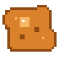 |
| `special_tiles.png` frames 14-15 (`SLOW`, `FAST`) | Slow and speed tiles | 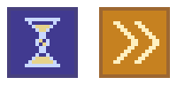 |
| `special_tiles.png` frames 16-19 (`TELEPORT_1`-`TELEPORT_4`) | The four teleporter pairs | 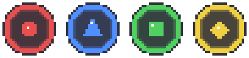 |
| `assets/sprites/hud/status_icons.png` cell 12 (`Icon.FAST`) | Status-bar icon over the player while on a speed tile ([StatusBars.gd](src/effects/StatusBars.gd)) | 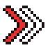 |
| `status_icons.png` cell 13 (`Icon.PASTE`) | Status-bar icon over whoever paste is holding | 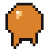 |
| Troll (no art of its own) | [Troll.tscn](src/enemies/Troll.tscn) uses the goblin's sprites with a gold `self_modulate`. Needs its own sprite set (stand, walk, slash, all four facings) | 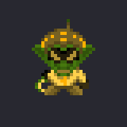 |
| Orc (no art of its own) | [Orc.tscn](src/enemies/Orc.tscn) uses the goblin's sprites scaled 1.5x (shown on the right, with a goblin on the left). Needs its own sprite set | 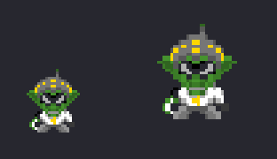 |
| Warlock (no art of its own) | [Warlock.tscn](src/enemies/Warlock.tscn) uses the wizard's sprites with a green `self_modulate` (see [Caster.gd](src/enemies/Caster.gd)). Needs its own sprite set (stand, walk, shoot) | 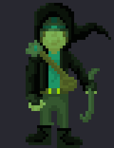 |
| Necromancer (no art of its own) | [Necromancer.tscn](src/enemies/Necromancer.tscn) uses the wizard's sprites with a purple `self_modulate`. Needs its own sprite set |  |

## Sound effects

All of these were synthesized by script for this project, so none of them is hand made or
from a library.

| Name | Used for | Preview |
| --- | --- | --- |
| `twinkle.wav` | An enemy's "about to strike" twinkle, and traps going live ([Juice.gd](src/autoload/Juice.gd)) | [assets/sfx/twinkle.wav](assets/sfx/twinkle.wav) |
| `tile_speed_up.wav` | Stepping onto a speed tile ([Player.gd](src/player/Player.gd)) | [assets/sfx/tile_speed_up.wav](assets/sfx/tile_speed_up.wav) |
| `tile_slow_down.wav` | Stepping onto a slow tile | [assets/sfx/tile_slow_down.wav](assets/sfx/tile_slow_down.wav) |
| `paste_stick.wav` | Thermal paste first catching someone ([SpecialTiles.gd](src/world/SpecialTiles.gd)) | [assets/sfx/paste_stick.wav](assets/sfx/paste_stick.wav) |
| `paste_stretch.wav` | Someone pulling against paste | [assets/sfx/paste_stretch.wav](assets/sfx/paste_stretch.wav) |
| `paste_snap.wav` | Paste snapping someone back | [assets/sfx/paste_snap.wav](assets/sfx/paste_snap.wav) |

## Music

None at the moment.

## Fonts

None at the moment.

## Source not verified

These aren't known to be placeholders, but nobody has recorded where they came from or
under what licence. Confirm the source and licence (and record them next to the asset), or
replace the asset.

| Name | Used for | Preview |
| --- | --- | --- |
| `assets/fonts/8-BIT WONDER.TTF` | Every menu and HUD label (Boot, PauseMenu, OptionsPanel, UpgradeMenu, GameCamera scenes) | [assets/fonts/8-BIT WONDER.TTF](<assets/fonts/8-BIT WONDER.TTF>) |
